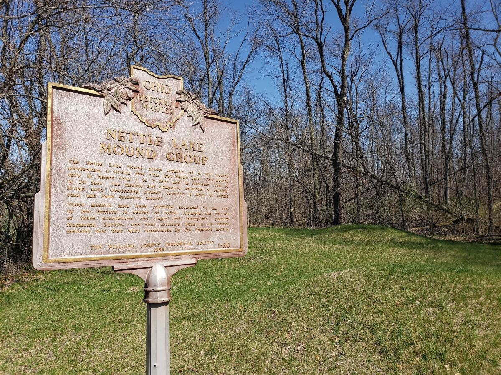



<figure>
  
  <figcaption><i>Nettle Lake Mound Group, Ohio. April 2026.</i></figcaption>
</figure>

Ohio is home to many celebrated archaeological attractions, like the celebrated Serpent Mound and the Newark Earthworks - now a UNESCO World Heritage Site. While most of well-known sites are in the southern or central regions of the Buckeye State, northern Ohio still holds many, albeit smaller, Native American mounds.

If you're an fan of archaeology, Indigenous history or local lore, and you happen to be driving through Williams County in rural northwestern Ohio, a stop at the Nettle Lake Mound Group is worth the detour. These small mounds don't offer the impressive photo-op that other Ohio mounds might, but they still offer a direct connection to the deep antiquity of the region. 

## Getting there and open hours

<iframe src="https://www.google.com/maps/embed?pb=!1m18!1m12!1m3!1d2323.877321582942!2d-84.731563!3d41.6875177!2m3!1f0!2f0!3f0!3m2!1i1024!2i768!4f13.1!3m3!1m2!1s0x883d9b002b9c7b77%3A0x2edf64d6c8d7eba4!2sNettle%20Lake%20Indian%20Mounds!5e1!3m2!1sen!2sus!4v1793068239338!5m2!1sen!2sus" width="400" height="300" style="border:0;" allowfullscreen="" loading="lazy" referrerpolicy="strict-origin-when-cross-origin"></iframe>

If you visit the mound group, don't expect a visitors center, museumm, restrooms or anything of the like. There is, however, a large sign along the road to mark the entrance. The sign reads:

<blockquote>
Hopewell Indian Mounds  
National Register of Historic Places  
Property of Williams County Historical Society  
Hours: May thru mid November 8 am to dusk  
Sign donated by Broken Arrow M.C. 2004
</blockquote>

While the sign said the mounds are only open from May to November, we visited in early April and found that the gate was unlocked and open.

## Historical details on the mounds 

An Ohio historical marker at the site provides a few details on the mounds:

<blockquote>
The Nettle Lake Mound group consists of 4 low mounds overlooking a stream that runs into Nettle Lake. The mounds vary in height from 1 to 3 feet and in diameter from 18 to 30 feet. The mounds are composed primarily of reddish-brown sand (secondary mound) covering a layer of darker sand and loam (primary mound).
</blockquote>

While the marker indicates that four mounds are present, I was only able to locate three while visiting the site. The fourth mound may be hidden in the nearby forest that surrounds the clearing at the site.

The sign continues:

<blockquote>
These mounds have been partially excavated in the past by pot hunters in search of relics. Although the records of these excavations are vague and incomplete, pottery fragments, burials, and flint artifacts found in the mounds indicate that they were constructed by the Hopewell Indians.
</blockquote>

The sign refers to the pot hunters conducting "excavations", but what it truly records is another sad instance in the widespread looting of Ohio's archaeological heritage during the 19th and 20th centuries. 

Unfortunately, without proper archaeological survey, we're left to the the analysis of looters for the designation of these mounds as "Hopewell". Archaeologists date the [Hopewell tradition](https://en.wikipedia.org/wiki/Hopewell_tradition) from 100 BC to 500 AD. 

## Connections to local lore

<iframe width="560" height="315" src="https://www.youtube.com/embed/iKdoggluf4E?si=i7TuMxo7VIg7WMu7" title="YouTube video player" frameborder="0" allow="accelerometer; autoplay; clipboard-write; encrypted-media; gyroscope; picture-in-picture; web-share" referrerpolicy="strict-origin-when-cross-origin" allowfullscreen></iframe>

The Williams County Library produced a video about the [Nettle Lake mounds and their connection to local folklore](https://www.youtube.com/watch?v=iKdoggluf4E), including tall tales of a cryptid inhabiting Nettle Lake and a 19th century settler who possessed an old "Indian drum" that guided him to treasure. Make of these stories what you will, they demonstrate the importance the mounds play in shaping the landscape of the region's settler folklore. 

## Related news

- [Late Precontact burial mounds in Michigan located near lakes with long maize growing season](https://kjbritt.github.io/archaeology/2026/03/02/michigan-mound-maize.html)
- [The surprising animal bones from Alaska's 13,800-year-old Shég’ Xdaltth’í’ site](https://kjbritt.github.io/archaeology/2026/10/18/fauna-sheg-xdaltthi.html)
- [Archaeologists unearth Alaska's 14,000-year-old mammoth ivory workshop](https://kjbritt.github.io/archaeology/2026/02/08/holzman-site.html)

